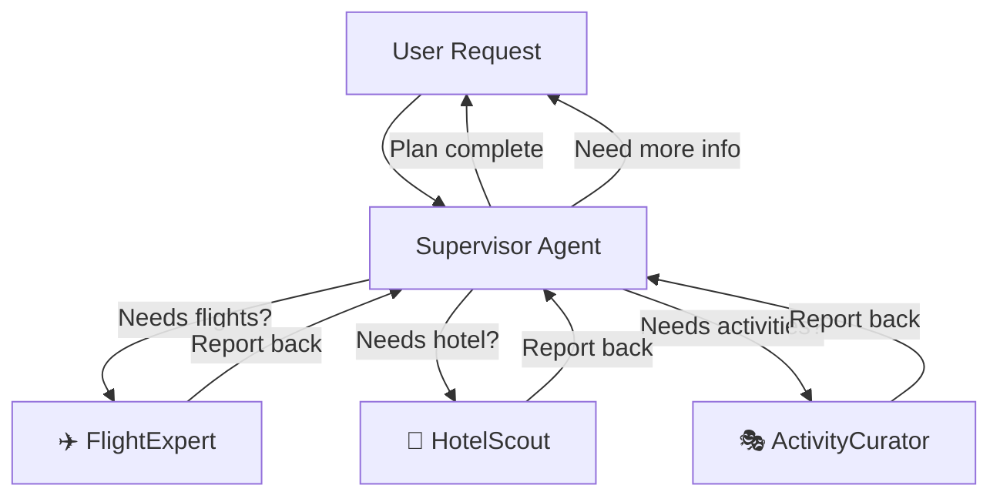

# Navigatio.ai 🌍✈️

**Navigatio.ai** is an AI-powered agentic trip planner that helps users plan their perfect vacation. Using Google's Gemini AI models and LangGraph orchestration, it provides real-time flight prices, hotel recommendations, and creates personalized travel itineraries.

## ✨ Features

- 🤖 **AI-Powered Planning**: Intelligent trip planning using Google Gemini via LangGraph
- 💬 **Interactive Chat Interface**: Natural conversation with the AI travel agent
- 🎨 **Modern UI**: Beautiful, responsive design with smooth animations
- 📊 **Visual Trip Planning**: Real-time visualization of your travel plans
- 🔄 **Multi-Agent System**: Specialized agents for flights, hotels, and itinerary planning
- 🌐 **Real-time Data**: Access to live flight prices and hotel information

## 🧠 Agentic Orchestration Architecture

Navigatio.ai uses a **multi-agent system** orchestrated via **LangGraph** to intelligently plan your trip. Here's how the agents work together:

### The Team

1. **🎯 Supervisor Agent** - The orchestrator that:
   - Receives user requests
   - Analyzes what needs to be done
   - Delegates tasks to specialist agents
   - Decides when the trip plan is complete

2. **✈️ FlightExpert** - Specialized in:
   - Finding the best flight options
   - Comparing airlines, times, and prices
   - Recommending optimal routes

3. **🏨 HotelScout** - Focused on:
   - Finding accommodation matching your style and budget
   - Recommending specific hotels with reasons
   - Considering location and amenities

4. **🎭 ActivityCurator** - Handles:
   - Discovering things to do at your destination
   - Balancing popular attractions with hidden gems
   - Finding great places to eat

### How They Collaborate

**The Workflow:**

1. **User sends a request** → The Supervisor analyzes it
2. **Supervisor delegates** → Calls the appropriate specialist(s)
3. **Specialist completes task** → Returns information to Supervisor
4. **Supervisor evaluates** → Decides if more work is needed or if the plan is complete
5. **Loop or finish** → Either delegates to another specialist or returns the final plan to the user

This architecture ensures:
- ✅ **Separation of concerns**: Each agent has a clear, focused role
- ✅ **Intelligent routing**: The supervisor only calls agents when needed
- ✅ **Scalability**: Easy to add new specialist agents
- ✅ **Quality responses**: Specialized prompts ensure expert-level recommendations

## 🚀 Installation

### 1. Clone the Repository

\`\`\`bash
git clone https://github.com/yourusername/Navigatio.ai.git
cd Navigatio.ai
\`\`\`

### 2. Frontend Setup

Install the frontend dependencies:

\`\`\`bash
npm install
\`\`\`

### 3. Backend Setup

#### Create a Virtual Environment

Navigate to the backend directory and create a Python virtual environment:

\`\`\`bash
cd backend
python3 -m venv venv
\`\`\`

#### Activate the Virtual Environment

- **macOS/Linux:**
  \`\`\`bash
  source venv/bin/activate
  \`\`\`

- **Windows:**
  \`\`\`bash
  venv\\Scripts\\activate
  \`\`\`

You should see `(venv)` appear in your terminal prompt.

#### Install Backend Dependencies

\`\`\`bash
pip install -r requirements.txt
\`\`\`

#### Navigate Back to Root Directory

\`\`\`bash
cd ..
\`\`\`

### 4. Environment Variables Setup

Create a `.env` file in the `backend` directory with your Google API key:

\`\`\`bash
# From the root directory
cp backend/.env.example backend/.env
\`\`\`

Now edit `backend/.env` and add your Google API key:

\`\`\`env
GOOGLE_API_KEY=your_actual_google_api_key_here
\`\`\`

> **⚠️ Important:** 
> - Get your Google API key from [Google AI Studio]
> - Never commit your `.env` file to version control
> - The `.env` file is already in `.gitignore` for your safety

## 🏃 Running the Application

### Option 1: Run Both Frontend and Backend Together (Recommended)

From the root directory, run:

\`\`\`bash
npm start
\`\`\`

This will start both the backend server and frontend development server concurrently. You should see output from both services in the same terminal window.

### Option 2: Run Frontend and Backend Separately

**Terminal 1 - Backend:**
\`\`\`bash
npm run backend
\`\`\`

**Terminal 2 - Frontend:**
\`\`\`bash
npm run dev
\`\`\`

### Access the Application

Once both servers are running, open your browser and navigate to:

\`\`\`
http://localhost:5173
\`\`\`

The backend API will be running on:

\`\`\`
http://localhost:8000
\`\`\`

You can check the backend health at: [http://localhost:8000/health](http://localhost:8000/health)

## 📂 Project Structure

\`\`\`
Navigatio.ai/
├── backend/                  # Python FastAPI backend
│   ├── app/
│   │   ├── main.py          # FastAPI application entry point
│   │   ├── graph/           # LangGraph workflow definitions
│   │   └── agents/          # Specialized AI agents
│   ├── venv/                # Python virtual environment (created during setup)
│   ├── requirements.txt     # Python dependencies
│   ├── .env                 # Environment variables (create from .env.example)
│   └── .env.example         # Environment variables template
├── components/              # React components
├── services/                # Frontend API services
├── App.tsx                  # Main React application
├── index.tsx                # React entry point
├── types.ts                 # TypeScript type definitions
├── package.json             # Node.js dependencies and scripts
└── README.md               # This file
\`\`\`

## 🛠️ Available Scripts

| Command | Description |
|---------|-------------|
| `npm start` | 🚀 Run both backend and frontend together (recommended) |
| `npm run dev` | Run only the frontend development server |
| `npm run backend` | Run only the backend server |
| `npm run build` | Build the frontend for production |
| `npm run preview` | Preview the production build locally |

## 🧪 Testing the Application

1. **Start the application** using `npm start`
2. **Open your browser** to [http://localhost:5173](http://localhost:5173)
3. **Try a sample query** like:
   - "I want to plan a trip to Paris for 5 days in June"
   - "Find me flights from New York to Tokyo"
   - "I need a hotel in Barcelona near the beach"

## 🔑 API Key Setup

### Getting Your Google API Key

1. Go to [Google AI Studio](https://makersuite.google.com/app/apikey)
2. Sign in with your Google account
3. Click "Create API Key"
4. Copy the generated API key
5. Paste it into `backend/.env`:
   \`\`\`
   GOOGLE_API_KEY=your_copied_api_key_here
   \`\`\`

### Free Tier Limits

Google's Gemini API offers a generous free tier:
- 60 requests per minute
- 1,500 requests per day

For production use, consider upgrading to a paid plan.

## 📄 License

This project is licensed under the MIT License - see the [LICENSE](LICENSE) file for details.
