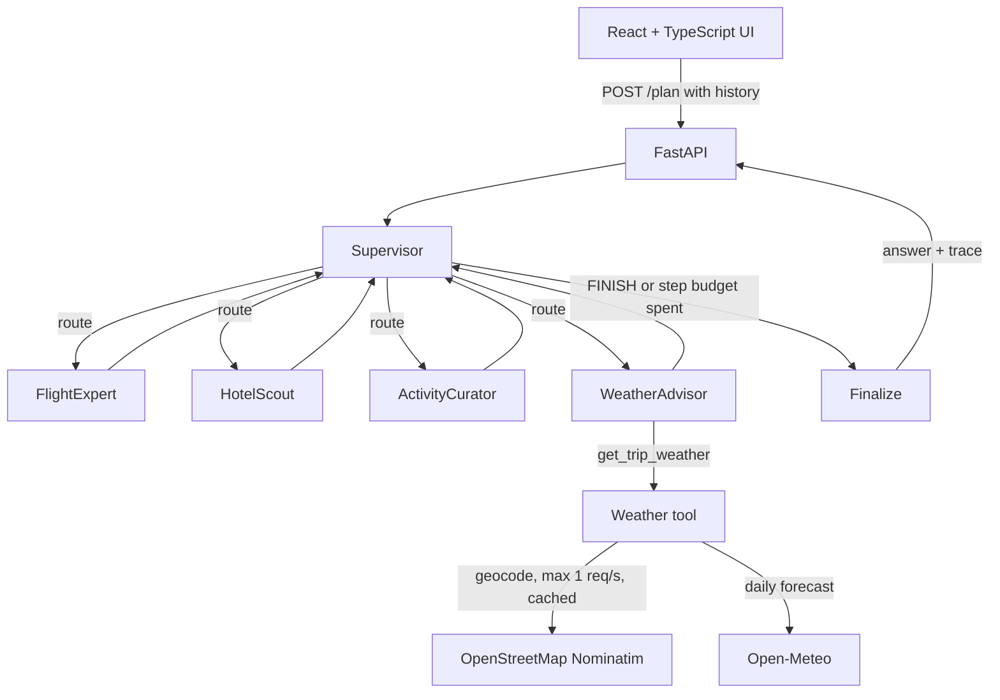

# Navigatio.ai

[](https://github.com/giovannigiofre/Navigatio.ai/actions/workflows/ci.yml)

Multi-agent trip planner built on LangGraph and Gemini. A supervisor agent reads the conversation and routes work to specialist agents (flights, hotels, activities, weather), then returns a consolidated plan to a React chat UI.

The point of this project is the orchestration layer: routing, termination, and state handling in a supervisor/worker graph, plus one external integration built with timeouts, retries, rate limiting and typed I/O. The weather forecast is live data; flights, hotels and activities are generated by the model and labelled as such (see Status).

## Architecture



- **Supervisor:** Gemini with structured output. It returns a `RouteDecision` (`next`: one of the specialists or `FINISH`, plus a one-line `reason`). It sees today's date, the step budget and which specialists already reported. Once `step_count` reaches `max_steps` it routes to `FINISH` without calling the model. An unparseable decision also ends the run.
- **Specialists:** one node per domain, each with its own system prompt. Earlier reports from the current request are passed into the system prompt under the author's name, so the message list always ends with the user's turn.
  - `FlightExpert`, `HotelScout`: no data source. The model gives typical options and price ranges. Each report starts with a fixed note, added in code, saying the results are illustrative examples and not live data.
  - `ActivityCurator`: model knowledge, labelled as such. It uses the WeatherAdvisor report, when present, to choose indoor or outdoor activities.
  - `WeatherAdvisor`: the model turns the conversation into `get_trip_weather` arguments (a tool call), the tool runs in code, and the model summarises the validated result.
- **Finalize:** writes one consolidated reply from the reports, or a clarifying question when no specialist ran. It appends a "Data sources" list built from the specialists that actually ran.
- **State (`TripState`):** `messages`, `next_agent`, `step_count` / `max_steps`, `finish_reason` (`supervisor`, `step_budget` or `router_error`), `sources`, and a per-node `trace` (node, latency, supervisor decision and reason, tool-call status).
- **Backend:** FastAPI. `POST /plan` takes `{message, history}` and returns `{request_id, response, steps, finish_reason, trace}`. `GET /health` is a liveness check.
- **Frontend:** sends the most recent chat turns with each request, shows a collapsible trace with each reply, and shows the latest run in a side panel.

### Weather integration

`get_trip_weather(destination, start_date, end_date)` geocodes the destination with Nominatim, then fetches the daily forecast from Open-Meteo. Neither API needs a key.

- **HTTP:** one shared `httpx.AsyncClient` per process, with explicit timeouts (connect 3 s, read 10 s, write 5 s, pool 5 s).
- **Retries:** `tenacity`, at most 3 attempts, exponential backoff from 0.5 s (capped at 4 s) plus up to 0.5 s of jitter. Only 5xx responses and timeouts are retried. 4xx responses, connection errors and malformed payloads fail immediately.
- **Nominatim policy:** identifying `User-Agent` (`HTTP_USER_AGENT`), an async rate limiter that keeps requests at least 1 s apart (retries included), and a 24 h in-memory TTL cache of geocoding results. The limiter and cache are per process.
- **Typed I/O:** Pydantic models for the tool input (`TripWeatherRequest`, with `end_date >= start_date` checked) and the output (`TripWeather | ToolError`). Upstream JSON is validated before use. The LangChain tool returns the result both as validated JSON content and as a typed `ToolMessage` artifact. WeatherAdvisor gives the model that validated JSON for its summary, never the raw upstream response.
- **Forecast window:** Open-Meteo forecasts cover 16 days. Trips partly inside the window are clipped, with a note; trips entirely outside return an `out_of_range` error without calling any API.
- **Deadline:** each lookup is capped at 20 s, retries and rate-limit waits included, so a hanging upstream cannot use up the whole run. WeatherAdvisor runs its lookups (at most 3) concurrently.
- **Failure handling:** these all become a `ToolError`: upstream failures (unreachable after retries, 4xx, malformed or invalid data, a missed deadline), unknown places, dates outside the forecast window, and invalid tool arguments from the model. The kinds are `invalid_input`, `not_found`, `out_of_range` and `upstream_unavailable`. If all tool calls fail, WeatherAdvisor returns a fixed "forecast unavailable" message with the reason and does not ask the model to write about weather. The final answer's data sources then say that no live forecast was available.
- **Logging:** every attempt is logged with service, attempt number, outcome, HTTP status and latency.

## Status

| Area | State |
|---|---|
| Supervisor routing | Structured output with `FINISH` as a valid choice. Tested with a scripted model and against a mocked Gemini REST API. Routing quality on the real model has not been measured yet (see Evaluation) |
| Termination | `FINISH`, a step budget (`MAX_STEPS`, default 6) and LangGraph `recursion_limit` as a backstop. All three are covered by tests |
| Multi-turn conversation | The UI sends the last 20 turns as `history`, skipping failed requests; the API validates roles and keeps the last `MAX_HISTORY_TURNS` (default 20) |
| Weather data | **Live**, from Open-Meteo, with Nominatim geocoding. Tests mock HTTP; CI never calls external services |
| Flight and hotel data | **Simulated by the LLM.** Labelled as illustrative, not live data, in each report and in the final answer |
| Activities | Model knowledge, labelled; not checked against live listings |
| API | Input validation; 90 s run timeout; Gemini requests time out after 30 s per attempt, with up to 2 attempts; one JSON error envelope; request ids; JSON application logs (uvicorn's own logs keep their default format) |
| Structured trip state | Not implemented: each agent re-reads the conversation |
| Itinerary view | None: the backend returns text, not a structured itinerary. The side panel shows the latest agent run instead |
| Streaming | None: the UI waits for the whole run, then shows the answer and trace |

## Testing & CI

```bash
cd backend
pip install -r requirements-dev.txt
ruff check . && ruff format --check .
pytest
```

The tests need no API key or network: sockets are blocked and `backend/.env` is not loaded during the run.

- **Graph** (`tests/test_graph.py`, `tests/test_weather_agent.py`): a scripted fake chat model drives supervisor decisions. They cover `FINISH`, routing, the step budget, invalid router output, history pass-through, report attribution, provenance labels, the trace, and WeatherAdvisor success, failure and invalid-argument paths.
- **Gemini client** (`tests/test_gemini_client.py`): the graph runs on the real `ChatGoogleGenerativeAI` client against a mocked Gemini REST endpoint. This checks JSON-schema routing requests, tool declarations and function-call parsing.
- **Weather tool** (`tests/test_weather_tools.py`): `respx` mocks Nominatim and Open-Meteo. Cases: success, timeout then retry then success, 5xx until retries run out (structured error), 4xx without retry, malformed and invalid payloads, the lookup deadline, cache hit, rate-limiter spacing, TTL expiry and the forecast window.
- **API** (`tests/test_api.py`): FastAPI `TestClient` with the graph dependency overridden. Covers `/health`, `/plan`, history capping, error responses that don't leak internals (422, 500, 502 for LLM errors, 504 for run and Gemini timeouts), CORS, startup without a key, and closing the HTTP client on shutdown.

Frontend: `npm ci && npm run typecheck && npm run build`.

GitHub Actions (`.github/workflows/ci.yml`) runs both on every push and pull request: backend on Python 3.12 with the pinned requirements, frontend on Node 22. pip and npm caches are enabled.

## Evaluation

`backend/evals/routing_cases.jsonl` has 14 labelled requests, each with the set of specialists it should call. They include full trips, single-domain requests, a trip beyond the forecast window, multi-turn follow-ups, clarifying-question cases and an out-of-scope question.

```bash
cd backend
python -m evals.run_routing_eval   # needs GOOGLE_API_KEY; calls Gemini and the weather APIs
```

It prints per-case routing precision and recall, steps and latency (plus the finish reason when a run did not end with `FINISH`), then the averages, the model id and the date. It is not part of CI, and no results are reported here because it has not been run yet.

## Design decisions

- **Supervisor/worker graph.** One router decides the next step, and each specialist owns one domain and prompt. Routing is explicit and inspectable in the trace, and a new specialist is one node plus one name in the routing schema. The cost is one extra LLM call per step.
- **Explicit step budget.** An LLM router can loop. Before this change the router could never pick `FINISH`, and a stubbed run made 10,007 model calls before LangGraph's default recursion limit stopped it. The budget bounds cost and latency per request whatever the model does. When it runs out, the finalizer still answers with what was gathered. `recursion_limit` is set just above the budget as a hard backstop: if it ever fired, the request would fail with a 500 instead of looping.
- **Real data where it is cheap, labelled simulation elsewhere.** Weather has free, keyless APIs, so it is live. Flight and hotel data need commercial APIs and keys, so those specialists stay simulated. The "not live data" labels are added in code, not left to the prompt.
- **Failures degrade to explicit gaps.** Tool failures become typed errors, and WeatherAdvisor states that the forecast is unavailable instead of generating one. The API maps the run timeout and Gemini timeouts to 504, other LLM provider errors to 502 and anything else to 500. Error messages are fixed, and a request id links them to the server logs.
- **Tool calls are bounded.** The model picks the arguments, code runs the tool (at most 3 concurrent calls, 20 s each), and the model summarises only validated data. There is no open-ended tool loop.

## Configuration

Backend settings are environment variables, read from `backend/.env` (see `backend/.env.example`):

| Variable | Default | Purpose |
|---|---|---|
| `GOOGLE_API_KEY` | (required) | Gemini API key |
| `GEMINI_MODEL` | `gemini-3.8-flash` | Gemini model id |
| `MAX_STEPS` | `6` | Specialist steps per request before the supervisor must finish |
| `MAX_HISTORY_TURNS` | `20` | Earlier chat turns passed to the agents |
| `GRAPH_TIMEOUT_S` / `LLM_TIMEOUT_S` | `90` / `30` | Time limit per `/plan` run and per Gemini request attempt |
| `ALLOWED_ORIGINS` | `http://localhost:3000,http://127.0.0.1:3000` | CORS allow-list |
| `HTTP_USER_AGENT` | `Navigatio.ai/0.1 (+repo URL)` | User-Agent for external APIs |
| `LOG_LEVEL` | `INFO` | Level of the JSON logs |

The frontend reads `VITE_API_URL` (default `http://localhost:8000`).

## Run locally

```bash
# backend
cd backend
cp .env.example .env        # add GOOGLE_API_KEY
python -m venv .venv && source .venv/bin/activate
pip install -r requirements.txt
uvicorn app.main:app --reload   # :8000

# frontend (repo root)
npm ci
npm run dev                  # :3000
```

`npm start` runs both with `concurrently` (the backend part needs the virtualenv active). With Docker, `docker compose up --build` serves the UI on :3000 and the API on :8000, reading `backend/.env`.

`python scripts/list_models.py` lists the Gemini models your key can call. `python -m scripts.smoke_graph "<request>"` streams one real run node by node.

## Roadmap

1. Run the routing eval on the real model and track results; add checks for plan completeness.
2. Structured trip state (destination, dates, budget) extracted once and shared across turns and agents.
3. Structured itinerary output (days, times, costs) the UI can render; the old placeholder itinerary panel was removed.
4. Stream progress to the UI (SSE) instead of returning everything at the end.
5. Shared rate limiter and cache (e.g. Redis) before running more than one backend process.
6. Authentication and per-client rate limiting on `/plan` before exposing it publicly: each request spends Gemini quota.

## Stack

LangGraph · Gemini (`langchain-google-genai`) · FastAPI · httpx · tenacity · Pydantic · React 19 · TypeScript · Vite
